# VisualWaveDrom 快速上手

先完成一张图，再按需要导入数据、分析波形、复用参数和演示讲解。**每段 GIF 展示实际操作，旁边的图解只标注这一步用到的 2～4 处，不再罗列全部按钮。** 蓝色编号是图内短注，GIF 橙框表示当前操作位置。

[从零绘制](#first-wave) · [等差填充](#wave-fill) · [复制粘贴](#copy-long-wave) · [导入数据](#import-data) · [数据格式与预设示例](#import-sample-files) · [示波器](#scope-hands-on) · [参数表](#parameters-hands-on) · [引用参数写法](#parameter-labels) · [演讲者模式](#presenter-hands-on) · [完整说明](ReadMe.md)

<a id="start"></a>
## 1. 启动

保留完整工具目录。Windows 双击 `VisualWaveDrom.bat`；Linux 在工具目录执行 `bash VisualWaveDrom.sh`。浏览器打开后，编辑期间不要关闭启动窗口。

以下演示使用独立的 `QuickStartDemo` 示例库，不含个人数据。右侧菜单可以左右分列，也可以分页；GIF 中会出现这两种布局，按钮功能相同。

<a id="first-wave"></a>
## 2. 创建一张波形图

1. 左侧点 **新增波形图**，新图自带 `clk`、`signal` 两行，并自动进入编辑状态。
2. 点 **文本编辑**，再单击新图标题，输入名称后按 `Enter`。
3. 再点文本编辑退出。蓝框表示当前操作的图。


## 3. 新增行并命名

1. 单击 `signal` 行，再点 **新增行**，空行插在它的下方；未选中行时加到末尾。
2. 开启 **文本编辑**，单击空行左侧的空白名称区，输入 `data`，回车确认。
3. 同样把 `signal` 改为 `valid`，然后退出文本编辑。


<a id="draw-wave"></a>
## 4. 绘制电平和数据波形

1. 保持 **修改模式**。单击 `valid` 的目标格，再点 `0` 或 `1`，绘制低、高电平。
2. 单击 `data` 行，开 **画笔模式**，选择数据类型 `=`，依次点 8 个格子。
3. 点 **退出画笔**。本例得到 8 个独立的数据段。


**注意：** 这里要逐格点画。拖选多格后一次替换为数据类型，会合并成一段，不适合下面的逐项等差填充。`4...` 是一段，`4444` 是四段。

<a id="multiline-data"></a>
## 5. 填写数据文字

按 `t` 或点 **文本编辑**，再单击数据段输入文字。`Enter` 确认，`Alt+Enter` 换行，`Esc` 取消。多行文字只增高这一条信号行。


<a id="wave-fill"></a>
## 6. 等差推理填充

1. 在第 4 节的 8 个数据段中，前两格分别填 `D01`、`D03`，然后退出文本编辑。
2. 拖选这两格，按住选区**右下角的小填充柄**，向右拖到第 8 格。
3. 松开后得到 `D05、D07……D15`。`Ctrl+Z` 可一次撤销。


原选区必须都是数据波形；虚线区只更新**已有数据段的文字**，不会把 `0`、`1`、`x` 或空白自动改成数据波形。更多规则见[推理填充说明](ReadMe.md#wave-fill)。

<a id="wave-hands-on"></a>
## 7. 双击按住，选择候选波形

退出文本编辑、画笔和连接选点模式。在同一格上，**第一下点按松开，第二下按住约半秒**，弹出候选菜单。松开后选一种波形；点菜单外或按 `Esc` 取消。


普通双击或默认按键 `q` 只在本分类内循环切换。没弹菜单时，检查 **设置 → 波形分类器** 是否开启。

<a id="copy-long-wave"></a>
## 8. 复制、粘贴一长段

1. 在源行按住左键向右拖选，松开后按 `Ctrl+C`。
2. 单击目标行的起始格，按 `Ctrl+V`；也可用菜单中的 **复制波形 / 粘贴波形**。
3. 从目标格开始覆盖后续格子，数据文字一起复制，目标信号名不变。


这段 GIF 使用较长的独立示例。选中多行也能复制，保留行列关系；可跨图粘贴。粘贴错了按 `Ctrl+Z`。

## 9. 新增连接

点 **新增连接**，依次选两格之间的起点、终点边沿，默认生成直线箭头。选完后按 `t` 输入标签，例如 `delay=2`，回车确认。


<a id="save"></a>
## 10. 保存波形库

点 **功能菜单 → 保存波形库**，等待保存完成。要保留原库、另存副本时点 **波形库另存为**。改完文字、切换图或退出编辑框，都不等于已经正式保存。


备份或交付时复制对应 `.sqlite` 文件，不是只发 HTML。需要静态图片时，点图框 **复制图片到剪贴板**，按 Word / PPT / Markdown 用途选择格式。

<a id="import-data"></a>
<a id="import-hands-on"></a>
## 11. 导入一个数据文件

需通过 BAT / SH 启动，本机有可用的 Python。

1. **功能菜单 → 导入波形数据**，选择文件；也可粘贴路径后点 **读取路径**，Linux 同样适用。
2. 等待前 5 行和推荐预设出现，填写信号名。第一列确实是序号时才勾选 **包含序号**。
3. 点 **生成预览**，核对后点 **确认导入**。


单列数据不勾序号，自动从 0 编号；复数会拆成 `_I`、`_Q` 两路。导入后还需 **保存波形库**。

<a id="collection-hands-on"></a>
## 12. 导入波形数据预设集合

1. 打开 **导入波形数据预设集合**，填**数据文件夹**，选择预设 JSON 或粘贴其路径后 **读取预设**。
2. 填写自动提取的变量，本例 `idx=0`；点 **搜索数据**。
3. 展开 TXT 核对内容。CSV 选择序号列、勾选所需信号；有需要再填写各列过滤条件并应用预览。
4. 核对后点 **确定导入**。保存预设可记住解析选择，保存波形库才正式保存导入结果。


不要把**数据文件夹**与**预设目录/文件**互换。下面用实际文件演示常见格式和预设写法；更多配置见[批量预设说明](ReadMe.md#import-batch)。

<a id="import-sample-files"></a>
### 12.1 先找到随工具提供的示例

以下例子均使用同一个**数据文件夹**：`inc/import/Data/QuickStart`。运行 BAT / SH 后，在导入窗口选择这个目录；不要选预设所在目录。各例建议在新建的波形图中分别尝试，避免同名信号相互覆盖。

| 想导入什么 | 选择的预设文件 | 配套数据文件 |
| --- | --- | --- |
| 单列数值、状态名称映射 | [01-single.json](inc/import/SchemeCollection/QuickStart/01-single.json) | [state.txt](inc/import/Data/QuickStart/state.txt) |
| 第一列为离散序号 | [02-indexed.json](inc/import/SchemeCollection/QuickStart/02-indexed.json) | [indexed/rx.txt](inc/import/Data/QuickStart/indexed/rx.txt) |
| 多通道、多轮测试文件 | [03-variables.json](inc/import/SchemeCollection/QuickStart/03-variables.json) | [run/rx_0_run1.txt](inc/import/Data/QuickStart/run/rx_0_run1.txt) 等 6 个文件 |
| CSV 标题、选列与筛选 | [04-table.json](inc/import/SchemeCollection/QuickStart/04-table.json) | [columns/capture.csv](inc/import/Data/QuickStart/columns/capture.csv) |
| 复数拆 I/Q、计算幅度/相位 | [05-iq-formula.json](inc/import/SchemeCollection/QuickStart/05-iq-formula.json) | [iq/rx.txt](inc/import/Data/QuickStart/iq/rx.txt) |
| 前后点引用、半周期公式 | [06-half-cycle.json](inc/import/SchemeCollection/QuickStart/06-half-cycle.json) | [capture.txt](inc/import/Data/QuickStart/capture.txt) |

本章中的 JSON 都是完整预设，可对照文件修改。`paths` 中每项是一条导入或生成规则：

- `usrGen`：自己填写的文件搜索、名称、映射或公式。
- `autoGen`：程序识别、在预览中确认后保存的解析配置。初次通常填 `{}` 即可；本文只在需要明确序号规则时预填 `hasSeq`。
- `InnerType`：自动搜索预设时的识别标记，保存预设会自动补上。
- `vars`：变量会从表达式中自动提取，不用手写变量列表；下面统一填 `[]`。

### 12.2 单列 TXT：一行就是一个采样点

**原始文件 `state.txt` 的全部内容：** 无标题、无序号，一行一个值。

```text
0
0
1
1
2
2
1
0
```

**对应预设 `01-single.json`：**

```json
{
  "InnerType": "VisualWaveDrom.BatchWaveImportPreset",
  "vars": [],
  "paths": [
    {
      "usrGen": {
        "folder": ".",
        "grepKeys": "^state\\.txt$",
        "name": "state",
        "tbl": { "0": "idle", "1": "active", "2": "done" }
      },
      "autoGen": { "hasSeq": false }
    }
  ]
}
```

搜索后**不勾选第一列为序号**，确认导入，得到 `state`，cycle 从 0 到 7。值 `1` 显示成 `1:active`，相同数据可合并显示；映射只改文字，不改变数值。`tbl` 可整项删除；JSON 的映射键必须写成 `"1"`，不能写裸数字 `1`。

单列也可使用 `-0.25`、`1.5`、`2e-3` 等数值。不要给普通单列数据勾选序号，否则小数可能被当成非法序号。

### 12.3 两列 TXT：离散序号与缺失位置

**原始文件 `indexed/rx.txt` 的全部内容：** 第一列为 cycle，第二列为数值，用空格或 Tab 分隔。

```text
2 10
5 20
9 15
```

**对应预设 `02-indexed.json`：**

```json
{
  "InnerType": "VisualWaveDrom.BatchWaveImportPreset",
  "vars": [],
  "paths": [
    {
      "usrGen": {
        "folder": "indexed",
        "grepKeys": "^rx\\.txt$",
        "name": "rx_indexed"
      },
      "autoGen": { "hasSeq": true }
    }
  ]
}
```

搜索后核对**第一列为序号**已勾选。导入后的值为：

| cycle 范围 | 显示值 | 为什么 |
| --- | --- | --- |
| 0～1 | `x` | 文件从序号 2 才开始 |
| 2～4 | `10` | 中间缺口延续上一个值 |
| 5～8 | `20` | 延续到下一条记录之前 |
| 9 | `15` | 最后一条实际记录 |
| 10 及以后 | `x` | 若其他行更长，尾部没有数据，不延长最后一个值 |

序号要求**非负整数、严格递增**，不要求连续。`2、5、9` 合法，重复序号或倒退不合法。文件文本预览的行号从 1 开始，不等于这里从 0 开始的 cycle。

### 12.4 变量批量匹配：一条规则导入多个文件

数据目录 `run` 中准备了 `rx_0_run1.txt`、`rx_0_run3.txt`、`rx_0_run5.txt`，以及通道 1 的另外 3 个文件。每个文件仍是[单列 TXT 格式](#import-sample-files)，例如 `rx_0_run1.txt` 的前 5 行：

```text
0.1000
0.4827
0.8071
1.0239
1.1000
```

**对应预设 `03-variables.json`：**

```json
{
  "InnerType": "VisualWaveDrom.BatchWaveImportPreset",
  "vars": [],
  "paths": [
    {
      "usrGen": {
        "folder": "run",
        "grepKeys": "^rx_{ch}_run{run}\\.txt$",
        "name": "rx"
      },
      "autoGen": { "hasSeq": false }
    }
  ]
}
```

1. 载入预设，窗口自动出现 `ch`、`run` 输入框。
2. `ch` 填 `0,1`，`run` 填 `1:2:6`，点 **搜索**。
3. 生成 2 × 3 组搜索，导入名为 `rx_ch0_run1`、`rx_ch0_run3`、`rx_ch0_run5`、`rx_ch1_run1`、`rx_ch1_run3`、`rx_ch1_run5`。

变量输入可写 `1:3`（1、2、3）、`1:2:6`（1、3、5）、`3:-1:1`（3、2、1）或逗号组合；留空按 `0`。只有具有多个候选值的变量才追加命名后缀，例如 `run` 只填 `1` 时不会追加 `_run1`。

`grepKeys` 使用 **Python `re`**，`{ch}` 是模板变量，不要写 `${ch}`，也不用加 `f`。JSON 中的 `\\.` 传给正则后表示字面句点；`^`、`$` 限定整个文件名。`folder` 相对数据根目录，只搜索该目录本身，**不递归搜索子目录**。同一组匹配多个文件时默认取排序后的第一个；要导入多个文件，使用变量组合或多条 `paths` 规则，不要只写一个宽泛正则。

### 12.5 带标题 CSV：选列、序号与筛选

**原始文件 `columns/capture.csv` 的前 11 行：** 第一行是标题，下面每行是一组同时刻采样；完整文件有 64 条记录。

```csv
Cycle,CurSt,SigA
0,0,2.0000
1,0,1.9616
2,0,1.8478
3,0,1.6629
4,0,1.4142
5,0,1.1111
6,0,0.7654
7,0,0.3902
8,1,0.0000
9,1,-0.3902
```

**对应预设 `04-table.json`：** 列名、标题行、分隔符先让程序识别，不必手填很多字段。

```json
{
  "InnerType": "VisualWaveDrom.BatchWaveImportPreset",
  "vars": [],
  "paths": [
    {
      "usrGen": { "folder": "columns", "grepKeys": "^capture\\.csv$" },
      "autoGen": {}
    }
  ]
}
```

1. 搜索后检查预览，标题行应为 `1`；若自己的文件前面有说明行，在文本框改实际标题行。
2. 序号列选 **Cycle**，勾选要导入的 `CurSt`、`SigA`；也可改导入后的信号名。序号列不再额外生成信号。
3. 在 `CurSt` **这一列自己的条件框**填 `>=1&&<=2`，点 **应用**，预览应只剩 32 条记录。只想用它作筛选条件时，可以不勾选导入 CurSt。
4. 若不需要保留原始时刻，把序号列改为 **不使用序号列**，筛选后的 32 条会重新从 cycle 0 编号；若保留 Cycle 列，则保留原始序号，内部缺口延续上一个值，首尾仍为未知。
5. **确定导入** 后，点 **保存预设**。列选择、改名、条件和序号列会写入 `autoGen`，下次不必重选。

**“筛选列名”只查找配置列表中的列，不筛采样记录。** 数据条件必须填在每一列对应的条件框。多个列同时有条件时，要同时满足这些列的条件才保留该记录。CSV 的复数列也可按下一节的形式填写；Tab 分隔的表格同样可通过预览确认。

### 12.6 复数 TXT：拆 I/Q，再计算幅度和相位

**原始文件 `iq/rx.txt` 的前 5 行：** 每行一个复数，使用 Python 常见的 `a+bj` 表示法，无标题、无序号。

```text
1.0000+0.0000j
0.9808+0.1951j
0.9239+0.3827j
0.8315+0.5556j
0.7071+0.7071j
```

**对应预设 `05-iq-formula.json`：** 第一项读文件，后面三项引用拆出的 `rx_I`、`rx_Q`。

```json
{
  "InnerType": "VisualWaveDrom.BatchWaveImportPreset",
  "vars": [],
  "paths": [
    {
      "usrGen": { "folder": "iq", "grepKeys": "^rx\\.txt$", "name": "rx" },
      "autoGen": { "hasSeq": false }
    },
    {
      "usrGen": {
        "name": "Magnitude",
        "formula": { "cycle0": "numpy.abs({rx_I} + 1j * {rx_Q})" }
      },
      "autoGen": {}
    },
    {
      "usrGen": {
        "name": "Phase",
        "formula": { "cycle0": "numpy.angle({rx_I} + 1j * {rx_Q})" }
      },
      "autoGen": {}
    },
    {
      "usrGen": { "name": "IQ overlay", "multiWave": ["rx_I", "rx_Q"] },
      "autoGen": {}
    }
  ]
}
```

预览会提示检测到复数。导入后共有 `rx_I`、`rx_Q`、`Magnitude`、`Phase`、`IQ overlay`：幅度约为 1，相位单位为弧度。`multiWave` 是把两条曲线叠在同一行，**不是数值相加**。公式依赖库自动识别；变量写 `{rx_I}`，不是参数表的 `{$rx_I}`。

复数也可带序号，例如 `2 1+2j`、`5 3-4j` 分别占一行，此时勾选第一列为序号；间隙补值规则与两列 TXT 相同。不要在普通逗号分隔 CSV 的一个单元格里直接写未经引号保护的 `1,2` 来表示复数，建议统一用 `1+2j`。

### 12.7 公式偏移与半周期

**原始文件 `capture.txt`** 是 0～63 的整数递增序列，仍是一行一个数。`06-half-cycle.json` 同时生成前一点和半周期插值：

```json
{
  "InnerType": "VisualWaveDrom.BatchWaveImportPreset",
  "vars": [],
  "paths": [
    {
      "usrGen": { "folder": ".", "grepKeys": "^capture\\.txt$", "name": "raw" },
      "autoGen": { "hasSeq": false }
    },
    {
      "usrGen": { "name": "previous", "formula": { "cycle0": "{raw}[-1]" } },
      "autoGen": {}
    },
    {
      "usrGen": {
        "name": "interpolated",
        "formula": { "cycle0": "{raw}", "cycle05": "({raw} + {raw}[1]) / 2" }
      },
      "autoGen": {}
    }
  ]
}
```

`{raw}[-1]` 取前 1 cycle，故 `previous` 在 cycle 0 为 `x`、cycle 1 为 `0`。偏移可为 0.5 的整数倍；不写偏移表示当前点。`interpolated` 在 0、0.5、1 cycle 的值分别为 0、0.5、1；最后一点之后取不到 `{raw}[1]`，相应公式输出未知。

`cycle0` 与 `cycle05` 可只填一个。**留空的相位不额外计算样本**：总线显示延续前值，模拟连续显示在实际样本之间插值；不是自动执行另一相位的公式。引用越界、缺少依赖或循环依赖时，请查看公式错误原因，不要把未知值当成 0。

### 12.8 结果不对时先检查这几处

- 找不到文件：看结果中的**实际正则**，核对数据根目录、`folder` 和变量值；没有匹配的项可跳过，不阻止其他有效项。
- 序号报错：普通单列数据不要勾序号；有序号时必须是严格递增的非负整数。
- CSV 没看到想要的信号：核对标题行、列勾选、序号列及各列条件，修改后重新应用预览。
- 公式全是 `x`：核对实际信号名，尤其是 `_I` / `_Q` 和多变量后缀，再检查偏移是否越界。
- 想下次复用：**保存预设**保存解析和公式配置；**保存波形库**保存实际导入的数据，二者不能互相代替。

<a id="scope-hands-on"></a>
## 13. 示波器：查看、计算和简化数据

导入完成后，点击这张图框上的 **示波器**。

1. 点 **A**、在图上定位；再用 **B** 设置另一端，底部 `B-A` 显示距离。点 **适应游标** 放大两者之间。
2. 再点 A / B 取消选中，左键拖出选区，按 `z` 或点 **适应选区**。
3. 点行尾 **总线** 打开卡片，按需改成 **模拟**；小数采样核对浮点类型。点 **适应窗口** 恢复全范围。


只查看不用保存。编辑后要保留时，先点示波器的 **保存修改** 或 **保存为展示实例**，再回主界面 **保存波形库**。

### 13.1 先看全貌，再定位细节

建议先导入上一章的 [CSV 示例](#import-sample-files)，再点图框上的 **示波器**，即可用 CurSt 和 SigA 跟着操作。

1. **适应窗口**看全范围；全局预览中的方框表示当前视口，按住拖动可快速移动到另一段。
2. 鼠标放在**全局预览波形**上滚轮缩放，也可点旁边 `+` / `-`。在主波形区可用中键按住左右拖动，或 `Shift+滚轮` 横向移动。
3. 不选 A/B 时，单击波形会出现 **C** 位置线；拖动 C 顶部标志可调整位置。左键拖出一段选区，按 `z` 放大到这段；`z` 需在波形区生效，不要在输入框里按。
4. 横轴 cycle 从 **0** 开始，而简化范围的“第几列”从 **1** 开始。例如 cycle 8 是第 9 列；设置简化范围前，先核对总长度。

缩放以当前选中的 A/B 游标为中心；未选游标时以当前选择位置为中心。离开视口的 A/B 标志会靠边显示，点击可跳回其真实位置。

### 13.2 游标测量与条件跳转

1. 点 **游标 A**，再点 CurSt 的 cycle 8；点 **游标 B**，再点 cycle 24。`B-A` 应为 `16 cycle`。再次点已选游标按钮或顶部标志可取消选中。
2. 点 CurSt 行选中它，在条件框填 `>=2`，用左右跳转箭头查找**由不满足变成满足**的边沿。示例第一次进入状态 2 的位置为 cycle 16。
3. 条件框留空表示跳到任意值变化沿；填 `2` 等价于相等比较；`1,2` 查找连续两个位置依次为 1、2 的组合，`>=1&&<=2` 表示范围条件。
4. A/B 没选中时，跳转移动 C；选中 A/B 时，跳转移动对应游标。波形区内也可按键盘左右方向键跳转。`Cur-A`、`Cur-B` 显示当前选择与 A/B 的距离，选区按左边界计算。

延续符 `.` 会按真实延续值判断，不当成一个独立数据值；含半周期样本或时钟时可落在 0.5 cycle。普通 1 cycle 信号在 8.5 处读取 cycle 8 的值。

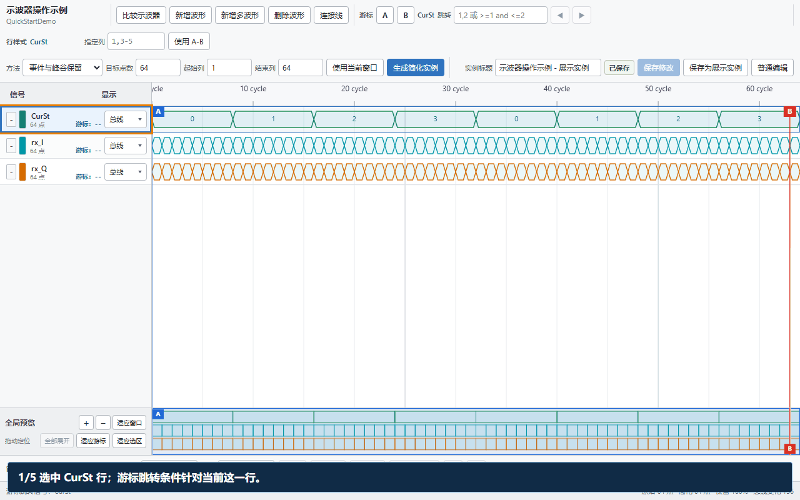

### 13.3 每行选择总线或模拟显示

点击信号信息栏的 **总线 / 模拟** 按钮打开配置卡片，设置只影响这一行。

| 目的 | 如何设置 | 用什么核对 |
| --- | --- | --- |
| 看状态、整数或位字段 | 总线；选择二/八/十/十六进制、位宽与有无符号 | CurSt 用十进制直接看 0～3 |
| 看小数或 I/Q 曲线 | 模拟；数据类型选浮点 | SigA 应是正负变化的曲线，不是全为 x |
| 看保持型采样 | 模拟 → 离散 | 每个 cycle 内是一条横线 |
| 看连续变化趋势 | 模拟 → 连续（默认） | 相邻真实样本以折线连接 |

点击信号名可改名；按住信号信息拖动可换行。模拟行边界可拖动调高。左侧颜色方块可改线色、整行背景和选区背景；先框选多列，再设置选区背景只作用于该范围。点行首 `-` 暂时收起，点 `+` 恢复；**全部展开**恢复所有行。

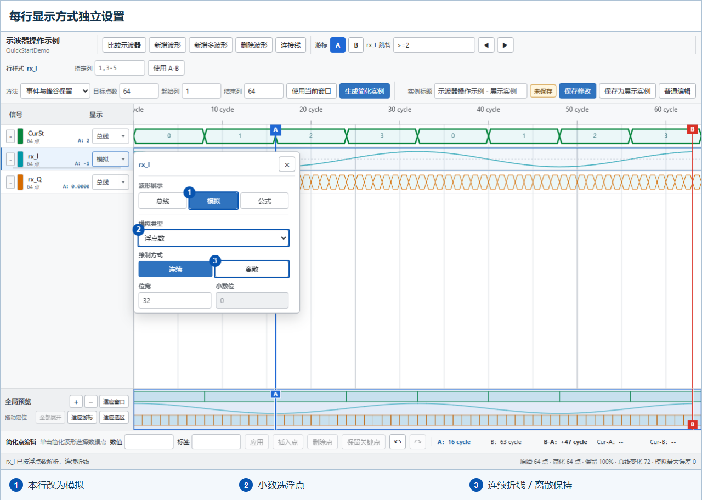

### 13.4 在示波器里新增公式

以 [I/Q 示例](#import-sample-files)为例，也可只导入它的第一条文件规则后，手动添加幅度行：

1. 选中一行，点 **新增波形**，新行出现在它下方；点击名字改为 `Magnitude_manual`。
2. 打开新行配置，展开 **公式**。在 **0 cycle** 填 `numpy.abs({rx_I} + 1j * {rx_Q})`，**0.5 cycle**留空。
3. 可先把光标放入公式框，再点 **插入变量**选择信号，程序自动插入 `{信号名}`。输入过程中不计算；点 **应用**才检查并生成结果。
4. 将本行设为 **模拟 → 浮点**，应看到约为 1 的曲线。展开转换后的 Python 或 JSON 预览检查内容；**复制 JSON**得到可放进预设 `paths` 的规则。

公式支持 math、cmath、numpy，依赖库自动识别；偏移与空相位含义见[公式偏移与半周期](#import-sample-files)。有错误时先检查提示，互相依赖的公式不能形成循环。

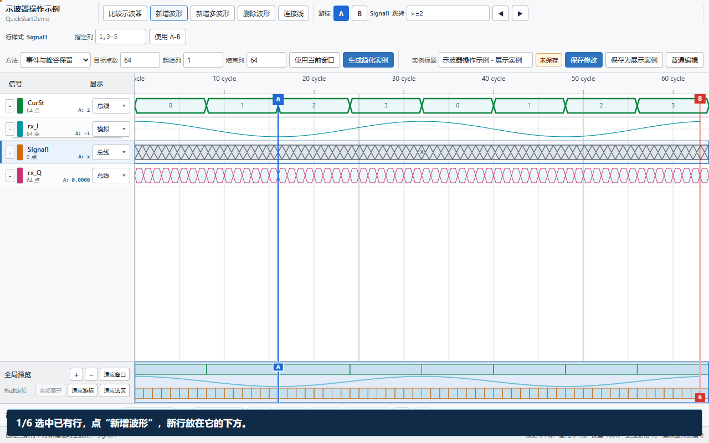

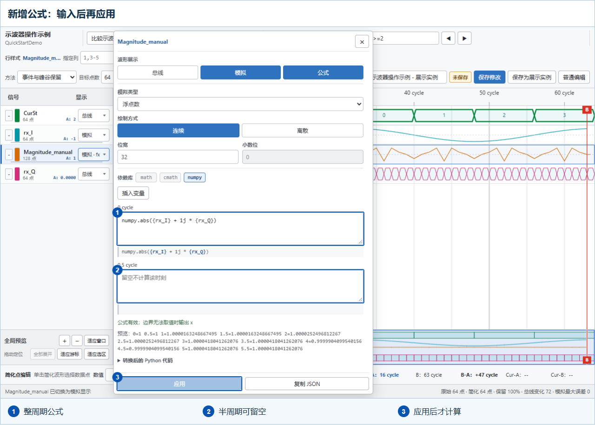

**想在同一行看 I/Q：** 点 **新增多波形**，选择 `rx_I`、`rx_Q` 并应用。图例纵向排列，点击图例显示/隐藏，悬停强调，拖动顺序改变遮挡层级；这不是把信号相加。公式配置要重复使用时保存到导入预设，不能只依赖未保存的示波器草稿。

### 13.5 把大量数据做成短小展示实例

1. 先缩放到关心的范围，点 **使用当前窗口**填写简化范围；或直接输入起止列。例如 CSV 的第 1～32 列对应 cycle 0～31。
2. 选择简化策略、目标点数（例如 12），点 **生成简化实例**。状态变化优先选 **跳变优先**，兼顾事件与峰谷选 **事件与峰谷保留**，连续曲线可选 **趋势与峰值**。
3. 在简化结果中选一个点，修改值或标签，再点 **应用**；也可插入、删除、锁定关键点。误操作用 **撤销 / 重做**。
4. 填展示标题，点 **保存为展示实例**：主目录新增一张简化图，原图保留。回主界面检查后点 **保存波形库**。

**保存修改**是更新当前所属图，**保存为展示实例**是另建图。只想制作讲解用的小示例时用后者，避免覆盖原始采集数据。显示方式、缩放与临时编辑不能代替正式保存。

### 13.6 比较两张图与标记差异（按需）

点击 **示波器比较**选择同库另一张图，可切换上下分屏、左右分屏或信号重叠。比较按信号名配对，重名行按顺序变成 `sig`、`sig_1` 等；错误只标具体位置。用错误跳转逐个检查，可添加、重命名错误位置标签，方便再次定位。公式生成的波形也参与比较。

完整的编辑、公式和比较选项见[示波器说明](ReadMe.md#scope)。

<a id="timing-series"></a>
## 14. 时延检查中的等差补全（按需）

这与第 6 节的拖动填充不同：时延检查是**只读展开预览**。例如数据为 `0、2、4、|、58`，已知步长为 2，可补出 `6、8……56`。

1. 功能菜单点 **显示 JSON**，将当前图替换为下面的小示例。
2. 点击 **时延检查**，选左侧 `data` 查看推算依据。
3. 点 **全部展开** 对照原序列。展开结果不会自动写回原图。

```json
{
  "signal": [{ "name": "data", "wave": "222|2", "data": ["0", "2", "4", "58"] }]
}
```


<a id="parameters-hands-on"></a>
## 15. 参数表：公共值只维护一份

位宽、延迟等数值会反复出现在图中时，先建参数表，避免到处手工修改标签。

1. 左侧切到 **参数目录 → 新增参数表**，输入表名 `公共参数`。新表自带一行空变量；点表名本身可改名。
2. 第一行填写 `N / 16 / 总线位宽`。点 **新增变量**，数量填 `2`，再按下表填写另外两行。
3. 输入完按 `Enter` 或点击别处确认。值中的公式在编辑时显示原文，结束编辑后显示蓝色计算结果；负数优先标红。

| 变量名 name | 变量值 val（输入内容） | 变量说明 description |
| --- | --- | --- |
| `N` | `16` | 总线位宽 |
| `delay` | `2` | 传输延迟，单位 cycle |
| `remain` | `{$N - $delay}` | 剩余周期数，显示结果为 14 |

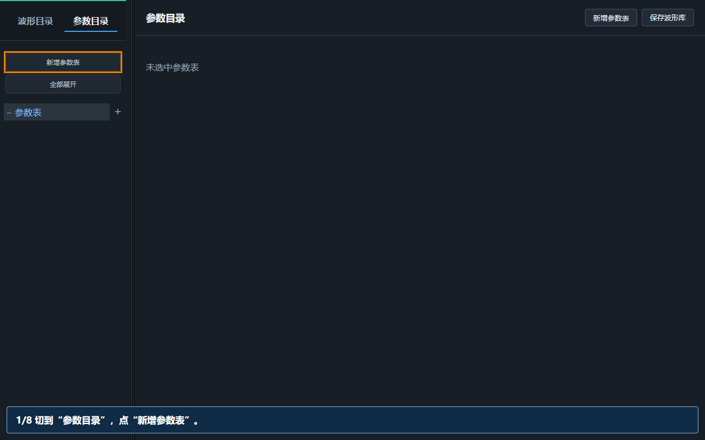

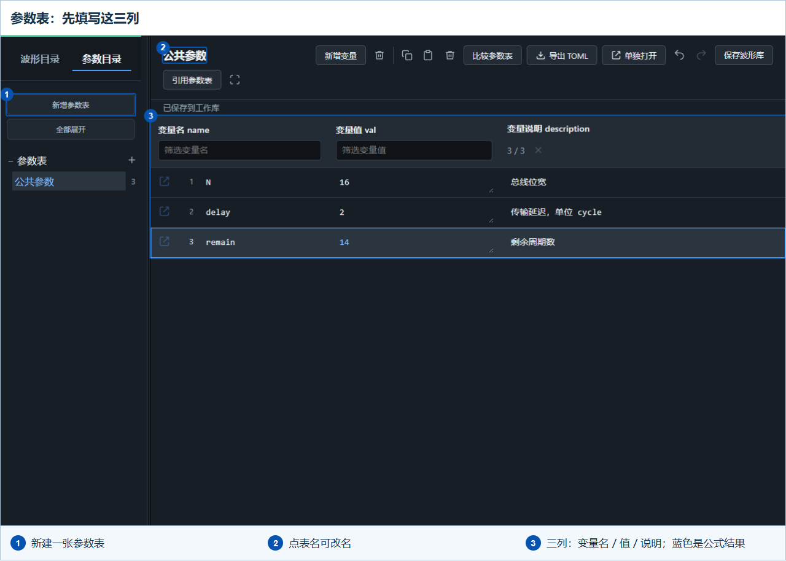

**不同工程只改少量参数时：** 新建 `工程参数`，本表只填 `N=20`，点 **引用参数表**，勾选 `公共参数` 并应用。公共内容出现在本表下方，不会复制或删除源表；本表的 `N=20` 优先，引用的 `delay=2` 继续使用，因此 `remain=18`。

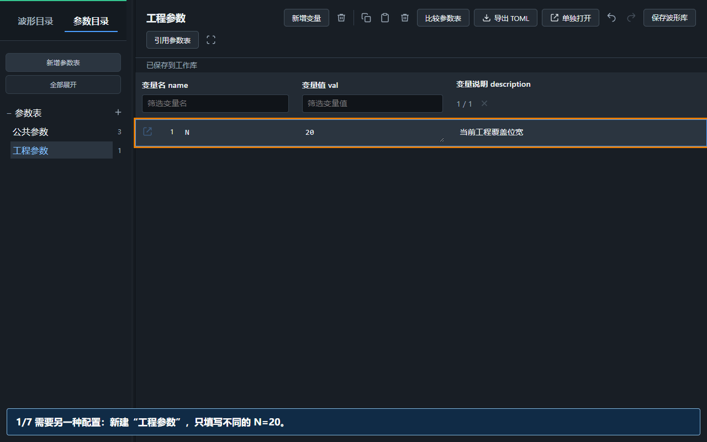

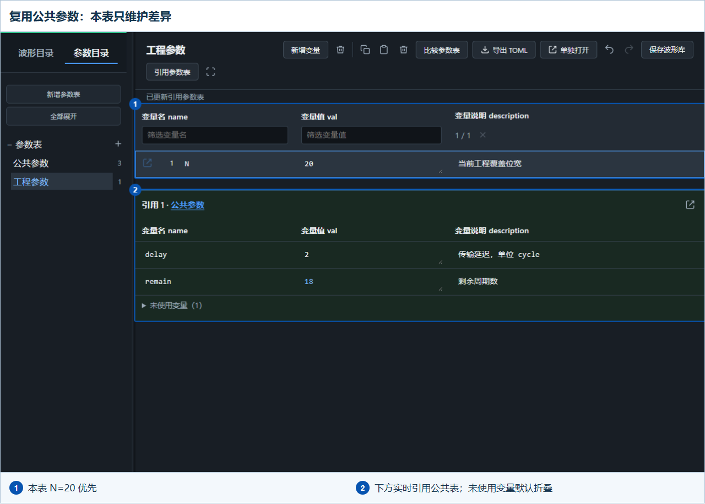

本表优先于所有引用表；多张引用表中，上面的表优先，可用 **修改引用顺序** 调整。被覆盖的同名变量默认折叠在 **未使用变量** 中。在引用区直接编辑会更新**源表**，其他使用它的表和图会同步更新。最终用 **保存波形库** 正式保存。筛选、复制、撤销及比较等见[参数表完整说明](ReadMe.md#parameter-matrix)。

<a id="parameter-link-hands-on"></a>
## 16. 在波形图中引用参数

### 先链接，再填写标签

1. 回到 **波形目录**，在目标图框点 **链接参数表**，本例勾选 `公共参数`。
2. 可同时选多张表，在右侧拖动调整顺序，**上方优先**。点 **添加预设** 可把表及其顺序存为 `接口参数`，供其他图选择。
3. 点 **应用**。以后改变组合或加载预设，也要点应用；最后 **保存波形库**，才会持久保存本图的链接和预设选择。

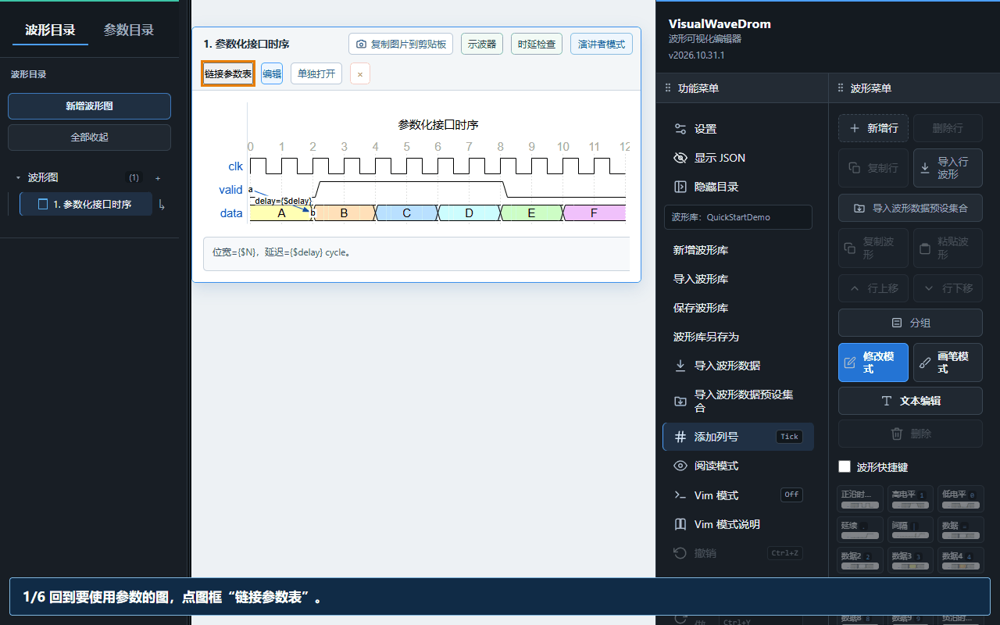

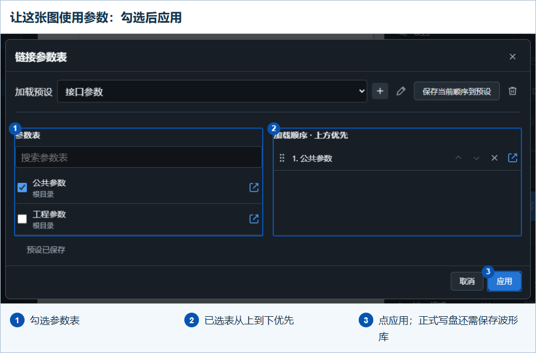

**区分两个入口：** 参数页的 **引用参数表** 用于“表复用表”；图框的 **链接参数表** 用于“这张图使用哪些表”。图链接 `工程参数` 时，已经包含它引用的公共参数，不必再重复链接公共表。

<a id="parameter-labels"></a>
### 几种常用写法

让图处于编辑状态，按 `t` 开启 **文本编辑**，单击数据标签输入表达式，按 `Enter` 确认。标题、信号名、连接标签及波形说明也支持参数引用。

以下按 `N=16、delay=2` 演示：

GIF 使用独立的“参数化接口时序”小图；也可以在前面创建的 `data` 数据段上逐个尝试。

| 编辑时输入 | 图上显示 | 用途 |
| --- | --- | --- |
| `{$N}` | `16` | 单个参数，不需要空格 |
| `位宽={$N}` | `位宽=16` | 参数和普通文字拼接 |
| `{$N + $delay}` | `18` | 参数相加 |
| `{$N * 2 - $delay / 2}` | `31` | 参数、常数及加减乘除 |
| `{max($N, 8)}` / `{min($N, 8)}` | `16` / `8` | 取最大值、最小值 |
| `{1 + 2 * 3}` | `7` | 不引用变量的纯常数计算 |
| `x{$N - 2}` | `x14` | 在计算结果前加文字 |
| `x{$N - 2:noTrans}` | `xN-2` | 图上保留变量名与运算符 |
| `{$delay - 4}` | 红色的 `-2` | 负数结果提示 |

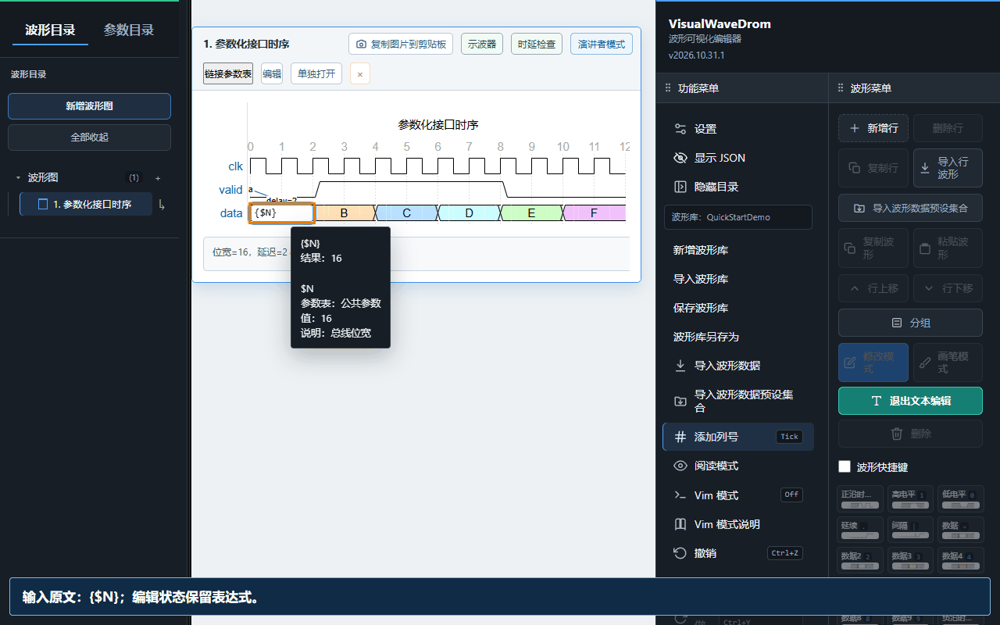

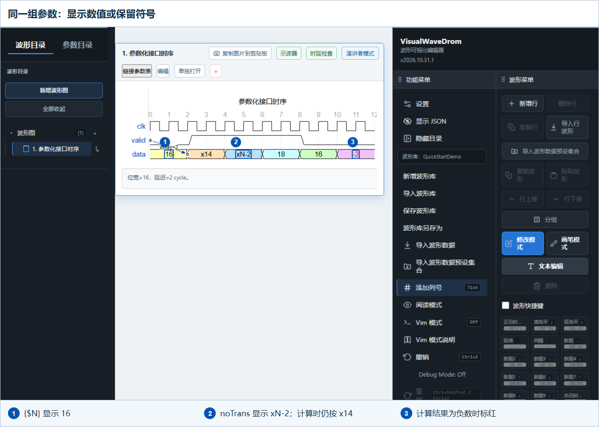

运算符两侧至少留一个空格，例如 `{$N - 2}`，不要写成 `{$N-2}`。悬停引用文字可查看取值来源、数值和说明；再次编辑仍看到原表达式，源 JSON 不会被显示值覆盖。找不到变量时检查本图是否已链接并应用对应参数表。

`noTrans` 只改变显示：上例图上是 `xN-2`，**时延检查仍先计算为 `x14`**，再参与等差补全和时延判断。它也适用于演讲者模式及截图。参数引用 `{$N}` 与示波器的采样公式 `{Signal}` 不是同一种写法。更多规则见[参数引用与运算](ReadMe.md#parameter-reference)。

<a id="presenter-hands-on"></a>
## 17. 演讲者模式：按步骤讲清一张图

适合评审、接口说明和制作讲解图片。点图框上 **示波器** 旁的 **演讲者模式**，单独打开讲解窗口；同一张图重复点击会复用已有窗口。

1. 点击顶部步骤文字，改为 `整体时序`。点 **聚焦**，选多行、多列或矩形，再在图中拖出范围；外部区域淡化，`Esc` 可清除聚焦。
2. 用底部 **画笔 / 箭头 / 文字** 添加批注。文字直接在图上输入，点完成确认；误操作用撤销或橡皮擦，不会擦掉底层波形。
3. 打开 **讲解备注**，写下自己要讲的内容。点 **新增步骤**，改步骤名，例如 `有效数据与延迟`；备注复制上一步，之后各步独立修改。
4. 点顶部 **保存**，保留演讲步骤和正式批注。退出时若有新改动会提示保存。
5. 点 **复制图片**，选择整张或仅聚焦区域；局部图片会带上信号名和批注。选 **生成 GIF**，勾选至少两个步骤，设置间隔后生成并下载。

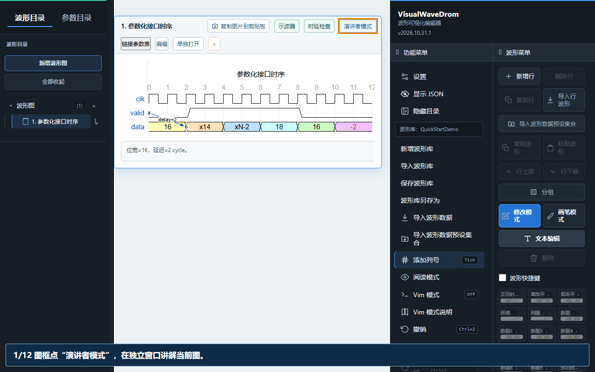

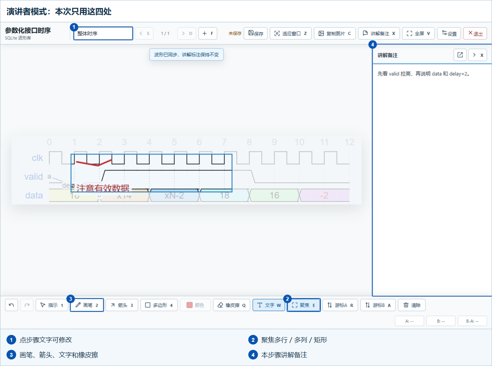

图和参数表在主界面修改后，会同步到演讲窗口并保留已有批注；源图若做大范围重排，仍需核对批注位置。参数的数值替换和 `noTrans` 规则与主界面一致。

图片和 GIF 不包含讲解备注、波形 `description` 或临时指示线；要保留并导出笔迹应使用 **画笔**，不是临时 **指示**。生成图片 / GIF 不等于保存步骤。分屏、颜色线宽、备注悬浮窗及快捷键见[演讲者完整说明](ReadMe.md#presenter)。

## 继续使用

[完整功能手册](ReadMe.md) · [目录管理](ReadMe.md#directory) · [参数表教程](#parameters-hands-on) · [参数写法](#parameter-labels) · [演讲者教程](#presenter-hands-on) · [Vim 手册](ReadMe.md#vim) · [常见问题](ReadMe.md#troubleshooting)

点文字没反应时，先确认这张图处于编辑状态，再开启文本编辑。保存失败时先保留网页和未保存内容，确认服务仍在运行，不要急着刷新。
